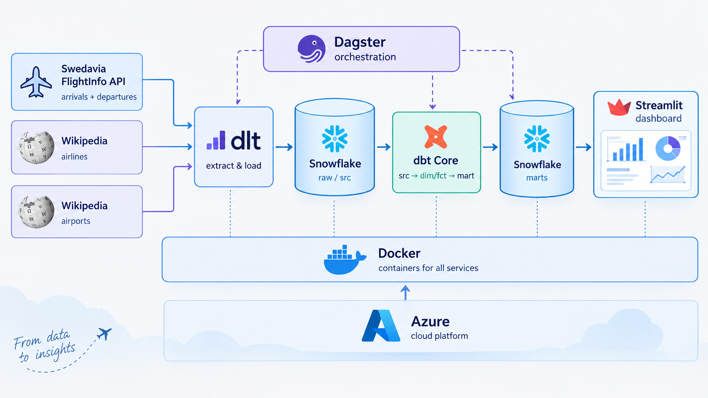
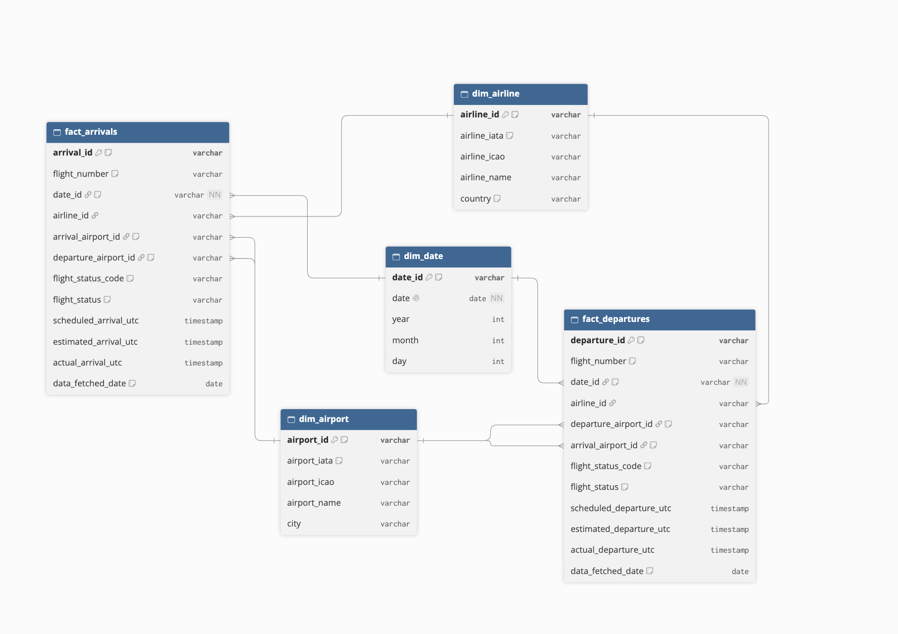

# ✈️ Flight Punctuality Analytics

A proof-of-concept modern data stack that analyses the punctuality of flights at Swedish airports. Data is extracted from the Swedavia FlightInfo API and Wikipedia, loaded into Snowflake, transformed with dbt, orchestrated with Dagster and visualised in a Streamlit dashboard.


---

## Table of Contents

1. [Background and Purpose](#1-background-and-purpose)
2. [Architecture](#2-architecture)
3. [Tech Stack](#3-tech-stack)
4. [Project Structure](#4-project-structure)
5. [Getting Started](#5-getting-started)
6. [Usage](#6-usage)
7. [Data Model](#7-data-model)
8. [Testing and Data Quality](#8-testing-and-data-quality)
9. [Deployment (Azure)](#9-deployment-azure)
10. [Known Limitations and Future Work](#10-known-limitations-and-future-work)
11. [Authors and Data Sources](#11-authors-and-data-sources)

---

## 1. Background and Purpose

This project was built as a two-week sprint by a team of data engineers working for a hypothetical Swedish airport authority. The goal is to deliver a proof of concept (PoC) that helps business stakeholders answer questions such as:

- How many arrivals and departures are delayed at Swedish airports?
- Which **airlines** have the most delays?
- Which **airports** are the least punctual?
- How do delays vary by **date**?

The pipeline extracts flight data covering the **past three days** (including the extraction date) for **all available airports in Swedavia data**, and makes it available in an interactive dashboard.

---

## 2. Architecture



| Step | Description |
|------|-------------|
| **Extract & Load** | `dlt` pulls arrivals and departures from the Swedavia FlightInfo API, plus airline and airport information from Wikipedia, and loads it into Snowflake. |
| **Warehouse** | Snowflake stores raw and transformed data, with separate roles, users, warehouse, database and schemas following access-control best practices. |
| **Transform** | `dbt Core` builds staging (`src`), dimension/fact (`dim`/`fct`) and `mart` models. |
| **Orchestrate** | `Dagster` schedules and runs the dlt and dbt steps as assets. |
| **Visualise** | `Streamlit` queries the mart layer in Snowflake and presents the dashboard. |
| **Containerise & Deploy** | Dagster and Streamlit run in separate Docker containers, deployed to Azure. |

---

## 3. Tech Stack

| Tool | Purpose | Why |
|------|---------|-----|
| **dlt** | Data extraction and loading | Lightweight Python-native ingestion with schema handling and incremental loading |
| **Snowflake** | Cloud data warehouse | Required by the project; separates storage and compute, supports role-based access control |
| **dbt Core** | Data transformation | SQL-based, version-controlled models with built-in testing and documentation |
| **Dagster** | Orchestration | Asset-based orchestration with schedules, sensors and a UI; integrates with dlt and dbt |
| **Streamlit** | BI dashboard | Fast development of interactive dashboards in Python |
| **Docker** | Containerisation | Reproducible environments for Dagster and Streamlit |
| **Azure** | Cloud deployment | Container App (Dagster) and Web App (Streamlit) |
| **dbdiagram** | Data modelling | Visual design of the dimensional model |
| **uv** | Python package management | Fast dependency management |

---

## 4. Project Structure

```
.
├── data_load_extract/     # dlt pipelines: Swedavia API + Wikipedia
├── data_transformation/   # dbt project (src, dim, fct, mart, macros, tests)
├── eda/                   # Exploratory work (.ipynb) and EDA
├── orchestration/         # Dagster project (assets, schedules, sensors)
├── streamlit_app/         # Streamlit dashboard
├── docs/                  # Data model diagram (dm_model.png) and other docs
├── docker-compose.yml     # Runs Dagster and Streamlit locally
├── .env.example           # Template for environment variables
├── pyproject.toml         # Python dependencies (uv)
└── README.md
```

---

## 5. Getting Started

### 5.1 Requirements

**Software:** [Docker](https://www.docker.com/) with Docker Compose and Git. To run without Docker you also need [uv](https://docs.astral.sh/uv/) and Python 3.13 (see `pyproject.toml`).

**Accounts:**

- **Snowflake** trial account (all team members develop within the *same* trial account)
- **Swedavia API key**: sign up at the [Swedavia developer portal](https://apideveloper.swedavia.se/) and subscribe to the FlightInfo API
- **Azure student account** (only needed for the [cloud deployment](#9-deployment-azure))

### 5.2 Set up Snowflake

Before the first run, set up Snowflake with the SQL scripts in `<path/to/snowflake_setup>`. The setup follows access-control best practices:

- Dedicated **roles** (e.g. loader, transformer, reporter) with least-privilege grants
- Dedicated **users** per role/service
- A dedicated **warehouse**, **database** and **schemas**
- No use of `ACCOUNTADMIN` for day-to-day work

### 5.3 Clone the repository and configure

```bash
git clone <repo-url>
cd <repo-name>
cp .env.example .env
```

All configuration is done through environment variables. See [`.env.example`](.env.example) for the full list of variables and example values. **Never commit `.env`.**

### 5.4 Start the stack

```bash
docker compose up --build
```

| Service | URL |
|---------|-----|
| Dagster UI | http://localhost:3000 |
| Streamlit dashboard | http://localhost:8501 |

### 5.5 Running without Docker (optional)

```bash
uv sync
# Dagster
uv run dagster dev -w <path/to/workspace.yaml>
# Streamlit (fill in your Snowflake credentials in .streamlit/secrets.toml first)
cp .streamlit/secrets.toml.example .streamlit/secrets.toml
uv run streamlit run streamlit_app/app.py
```

---

## 6. Usage

### Running the pipeline

1. Open the Dagster UI at http://localhost:3000.
2. Go to **Assets** and click **Materialize all** (or select specific assets).
3. Dagster runs the dlt extract/load steps first, then the dbt models.
4. Follow progress and logs under **Runs**.

### Using the dashboard

1. Open http://localhost:8501.
2. Use the filters (e.g. date, airport, airline) to explore delayed arrivals and departures.
3. Compare airlines and airports to identify where delays are concentrated.

---

## 7. Data Model

The transformed data is modelled as a **dimensional model** (star schema), designed in [dbdiagram](https://dbdiagram.io/).



### Layers

| Layer | Prefix | Description |
|-------|--------|-------------|
| **Source / staging** | `src_` | Cleans and standardises raw data from dlt (renaming, type casting, deduplication) |
| **Dimensions** | `dim_` | Descriptive entities: airlines, airports, dates |
| **Facts** | `fct_` | Flight events (arrivals and departures) with delay measures, linked to dimensions |
| **Marts** | `mart_` | Business-ready aggregates for the dashboard, e.g. delayed arrivals and departures by airline, airport and date |

---

## 8. Testing and Data Quality

Data quality is checked with dbt tests defined in the `schema.yml` files:

- `not_null`: key columns must not be empty
- `unique`: primary keys must be unique

Run the tests:

```bash
cd data_transformation
dbt test
```

To build the models and run the tests in one go:

```bash
dbt build
```

---

## 9. Deployment (Azure)

Dagster and Streamlit are containerised separately and deployed to an Azure student account.

| Component | Azure resource |
|-----------|----------------|
| Dagster | Azure **Container App** |
| Streamlit | Azure **Web App** |

### Push images to Azure Container Registry

```bash
# Log in
az login
az acr login --name <registry-name>

# Build, tag and push
docker build -t <registry-name>.azurecr.io/dagster:latest -f <path/to/Dockerfile.dagster> .
docker push <registry-name>.azurecr.io/dagster:latest

docker build -t <registry-name>.azurecr.io/streamlit:latest -f <path/to/Dockerfile.streamlit> .
docker push <registry-name>.azurecr.io/streamlit:latest
```

Then configure the Container App and Web App to pull the images from the registry and set the environment variables in [`.env.example`](.env.example) as application settings/secrets.

---

## 10. Known Limitations and Future Work

- Only the past three days of data are extracted. No long-term history is kept yet
- Delay metrics depend on the quality and completeness of the Swedavia API data
- Wikipedia data may be incomplete or change over time
- More dbt tests (e.g. `relationships`, `accepted_values`) could be added
- Alerting on failed Dagster runs
- Additional analyses, e.g. delay causes, time of day, weather

---

## 11. Authors and Data Sources

**Authors:**

| Name | GitHub |
|------|-------|
| Miranda Lyng | [@mirandalyng](https://github.com/mirandalyng) |
| Lisa Yllander | [@LisaYllander92](https://github.com/LisaYllander92) |
| Alexandra Kaktus | [@cactus-commits](https://github.com/cactus-commits) |
| Rickard Garnau | [@rickard-garnau](https://github.com/rickard-garnau) |
| Filippa Jansson | [@Filippa-Jansson](https://github.com/Filippa-Jansson) |

**Data sources:**

- [Swedavia FlightInfo API](https://apideveloper.swedavia.se/): arrivals and departures
- Wikipedia: airline operators
- Wikipedia: airports
- [Dagster docs: creating projects](https://dagster.io/docs/guides/build/projects/creating-projects)

*Project developed as part of a data engineering course.*